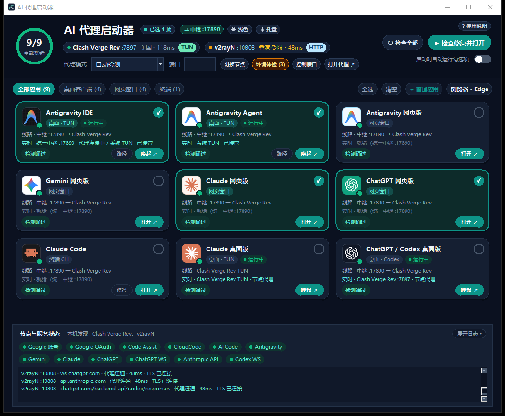
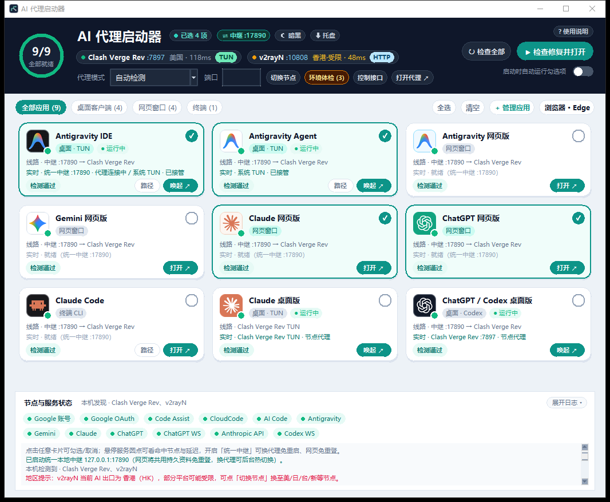
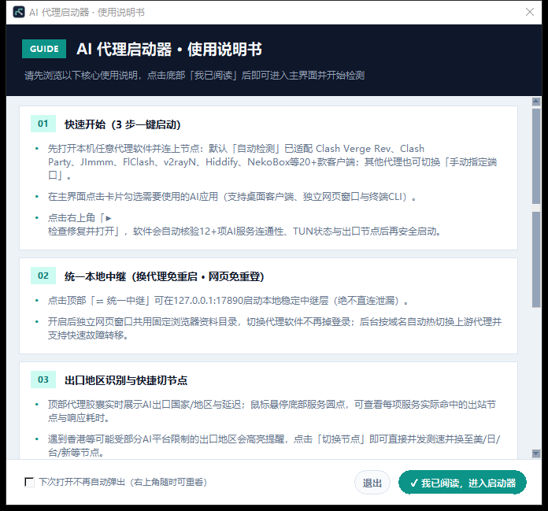
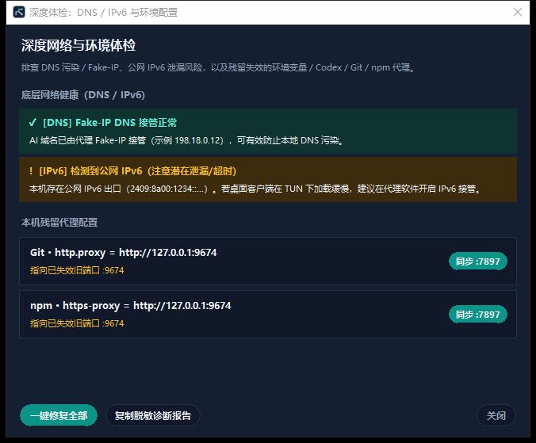

<div align="center">

# AI 代理启动器 (AIProxyLauncher)

**跨平台（Windows / macOS）AI 客户端与网页代理启动器**  
*100% 纯 Python 3.11+ 标准库 · 零第三方运行时依赖 · 全协议代理与套壳客户端通用适配*

**简体中文** · [English](README.en.md)

[](../../releases)
[](#从源码运行与构建)
[](../../releases/latest)

<br />



</div>

---

## 界面预览

<table>
  <tr>
    <td width="50%" align="center">
      
      <br />
      <b>浅色主题 · 健康圆环与 3×3 官方图标卡片</b>
    </td>
    <td width="50%" align="center">
      
      <br />
      <b>暗黑主题 · 统一本地中继与实时线路状态</b>
    </td>
  </tr>
  <tr>
    <td width="50%" align="center">
      
      <br />
      <b>启动前置使用说明书（确认后收起至右上角随时重阅）</b>
    </td>
    <td width="50%" align="center">
      
      <br />
      <b>DNS / IPv6 深度排查、旧端口一键修复与脱敏报告</b>
    </td>
  </tr>
</table>

---

## 下载安装包

前往右侧 **[Releases（最新版）](../../releases/latest)** 页面直接下载编译好的可执行程序：

| 平台 | 文件 | 说明 |
| :--- | :--- | :--- |
| **Windows (x64)** | `AIProxyLauncher.exe` | 单文件绿色版，双击即用，无需安装 Python |
| **macOS (Apple Silicon)** | `AIProxyLauncher-macOS-arm64.zip` | 解压后双击 `AIProxyLauncher.app`（已内置自动加载 macOS 系统根证书） |
| **macOS (通用源码包)** | `AIProxyLauncher-macOS-Source.zip` | 兼容 Intel & Apple Silicon，需 Python 3.11+（带 Tk），双击 `macos-start.command` 运行 |

详细使用与排查请参阅：[Windows 使用说明](使用说明.md) ｜ [macOS 使用说明](macOS使用说明.md)

---

## 核心特性

- **通用代理与套壳客户端 4 层零名单适配**
  - 原生适配 Clash Verge Rev、Clash Party / Mihomo Party、JImmm、FlClash、Clash Nyanpasu、Sparkle、ClashX、Stash、Surge、v2rayN、Hiddify、NekoBox / Throne、Karing、Shadowsocks、Xray / Sing-box 等 20+ 客户端。
  - **目录骨架指纹 + 真实品牌名识别**：无需维护机场名单，自动识别改名套壳的 FlClash / Mihomo / Sing-box / Xray 客户端，并直接读取 Windows PE 版本信息或 macOS `Info.plist` 显示真实品牌名。
  - **协议优先嗅探 + 纯 TUN 无端口兜底**：自动嗅探常见代理端口的 Clash API / HTTP / SOCKS5 协议与自定义命名管道 / Unix Socket；仅开启系统 TUN 无本地端口时自动直通校验；系统代理指向死端口或外壳在跑但内核未启动时精准提示原因。
- **统一本地中继（换代理免重启 · 网页免重登）**
  - 点击顶部 `⇄ 统一中继` 在 `127.0.0.1:17890` 启动纯标准库 HTTP/CONNECT 稳定中继层（[relay.py](relay.py)）。
  - 独立网页窗口共用固定浏览器资料目录，切换代理软件不再掉登录；后台按域名热切换上游并支持 `350ms` 快速故障转移，无可用上游时严格返回 `HTTP 502`，绝不直连泄漏。
- **按 AI 服务精准识别出口节点与地区**
  - 直接针对 `chatgpt.com`、`claude.ai` 等 AI 域名探测出口地区，并从 Clash `/connections` 实时提取 12+ 项服务各自命中的出站节点名与延迟；遇受限地区自动高亮提醒并在择优与换节点时自动避开。
- **内置切节点、DNS/IPv6 深度体检与脱敏报告**
  - 弹窗内直接浏览分流组、并发测速并切换节点。
  - 自动审计并带 `.bak` 备份一键修复 Windows 环境变量、`.codex/.env`、`.gitconfig`、`.npmrc` 中的失效旧代理端口；排查 DNS 污染 / Fake-IP 异常与公网 IPv6 泄漏，支持一键复制不含密钥与个人路径的脱敏诊断报告。
- **零子进程原生底层与现代桌面体验**
  - Windows 底层通过 `ctypes` 直接调用 Win32 异步重叠命名管道（`~0.4ms`）与 `iphlpapi.GetExtendedTcpTable` 内核 TCP 表（[win32net.py](win32net.py)），零 `powershell.exe` / `netstat.exe` 轮询开销。
  - 16 款内置及扩展预设（含 Cursor、Windsurf、VS Code、Gemini CLI、Codex CLI、Grok、Perplexity）均配备官方高清图标；支持启动引导说明书 + 右上角随时重阅、系统托盘、单实例防多开唤醒、开机静默自启（`--minimized`）及休眠/系统代理变更看门狗。

---

## 从源码运行与构建

```bash
# 运行（需要 Python 3.11+ 及内置 Tkinter，零第三方依赖）
python launcher.py

# 静默启动到系统托盘
python launcher.py --minimized

# 命令行探针检查（输出 JSON）
python launcher.py --check

# 运行全量单元测试（72 项）
python -B -m unittest -v
```

### 本地打包

- **Windows**：
  ```powershell
  .\build-windows.ps1              # 跑测试 + 打包 新版\AIProxyLauncher.exe + 刷新 macOS 源码包
  .\build-windows.ps1 -SourceOnly  # 仅跑测试并刷新 macOS 源码包
  ```
- **macOS**：
  ```bash
  bash build-macos.sh              # 生成当前架构 AIProxyLauncher.app 与 ZIP
  bash build-macos.sh universal2   # 使用 Universal2 Python 构建通用架构包
  ```

### 自动发布（GitHub Actions）

推送 `v*` 标签（如 `git tag v2.3.0 && git push origin v2.3.0`）或在 Actions 页面手动触发 **Build & Release** 工作流（[.github/workflows/release.yml](.github/workflows/release.yml)），即可自动在 Windows 与 macOS 云端运行全部测试、签名校验并发布全平台可执行文件到 GitHub Releases。

---

## 安全与隐私原则

- 所有本地代理中继与控制接口均严格限定在 `127.0.0.1` / 本地命名管道 / 本地 Unix Socket，绝不绑定公网网卡或回退直连外网。
- 控制接口密钥仅保存在当前内存会话中，绝不写入配置文件；一键复制的诊断报告自动脱敏，不包含密钥或个人本地路径。
